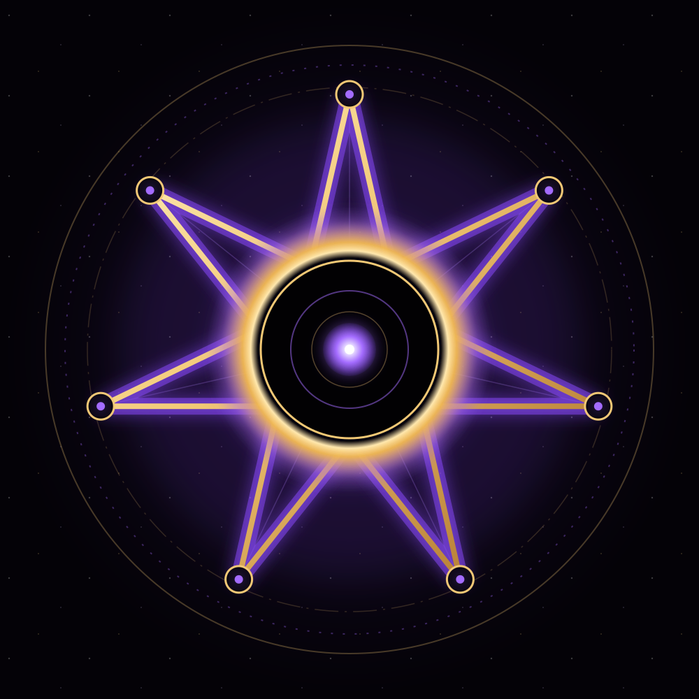

# Eclipse Node Theta-7

A self-contained seven-step reflection experience built with plain HTML, CSS, and JavaScript.



## Experience

Theta-7 combines a seven-pointed eclipse sigil with three user-controlled modes:

- **Observe** for open-ended attention
- **7 Prompts** for seven practical questions at the user’s pace
- **Breathe** for seven guided 4-2-6 cycles

The interface also includes optional local tones, reduced-motion support, a browser-saved reflection field, and local Markdown download.

## Run locally

Open `site/index.html` directly, or start the included static server:

```bash
npm ci
npm run serve
```

Then open `http://127.0.0.1:4173`.

## Validate

```bash
npm test
npm run test:browser
npm run verify:manifest
```

Browser testing requires Python 3, Chromium, and the pinned package in `requirements-browser.txt`.

## Privacy and use boundary

The application has no account, analytics, backend, or data upload. On a hosted copy, saved reflections are stored unencrypted in the active browser profile and may be visible to other users of that profile. A directly opened `site/index.html` keeps reflections in the open tab only, because browsers can share one storage area across all local files; use **Download** to keep a copy.

Theta-7 is symbolic art and reflective software. It does not verify paranormal, extraterrestrial, medical, or intelligence claims and should not guide health, safety, travel, or investigative decisions.

## Repository map

- `site/` deployable static experience
- `tests/` repository and browser interaction checks
- `scripts/` local server, manifest, and release packaging tools
- `docs/` architecture, validation, release, and use-boundary records
- `.github/workflows/ci.yml` minimal continuous validation

## Repository state

**Version:** 1.2.2
**License:** MIT
**Status:** Published on `main`; continuous integration validates every push. No automatic site publication is configured.
